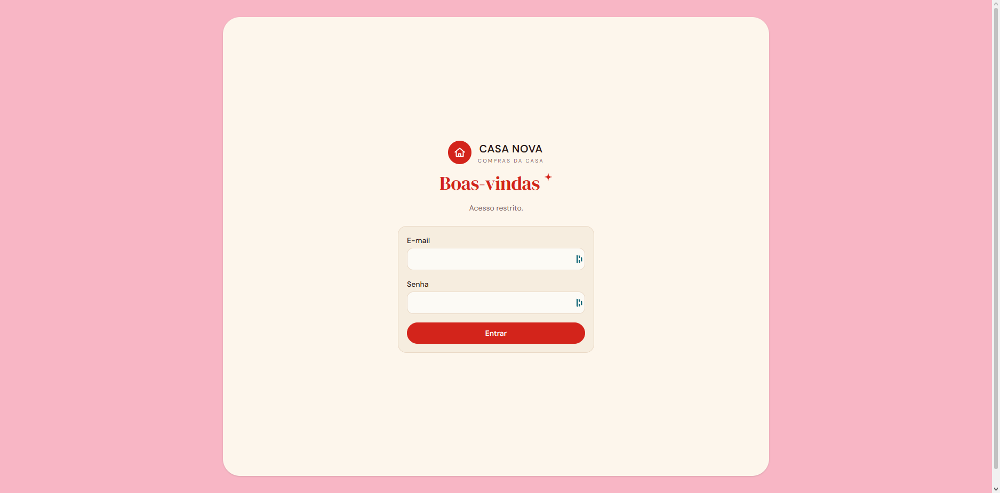
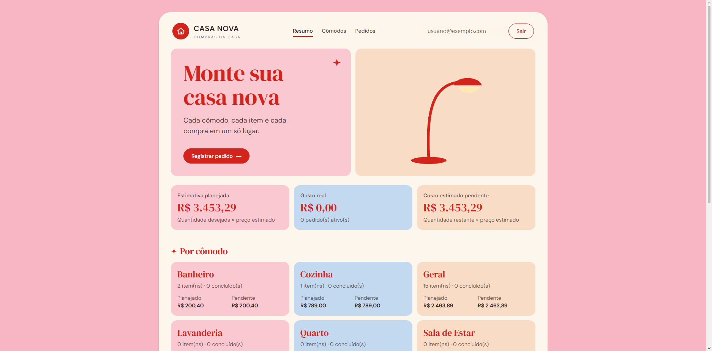
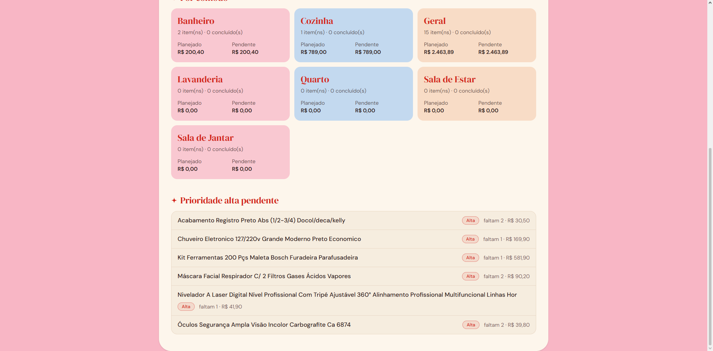
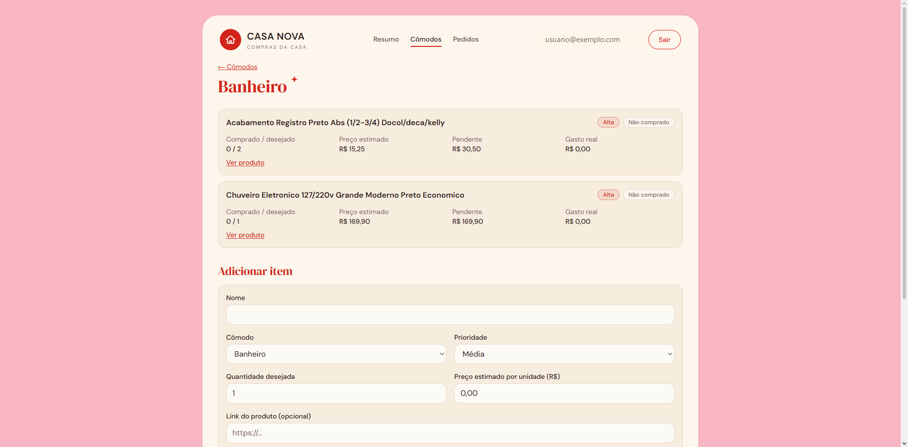
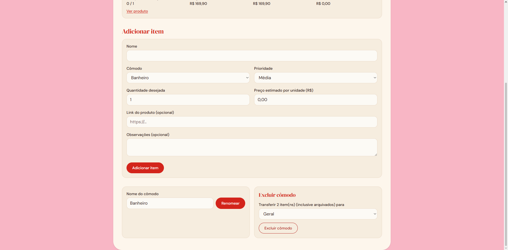
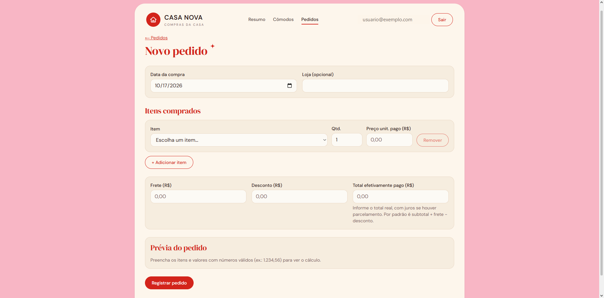

# Casa Nova

Aplicação web responsiva para organizar as compras de uma casa nova: **cômodos, itens, pedidos** com frete, desconto e juros, **gasto real** e **custo pendente**, sempre com os valores calculados de forma exata (em centavos).

Projeto pessoal, de usuário único, construído de ponta a ponta: modelagem de dados, regras financeiras, segurança, testes e deploy.

> **Demonstração:** o app é privado (login de uma única conta), então não há link público para uso. Para ver o resultado, veja as capturas de tela abaixo ou rode localmente seguindo [Desenvolvimento local](#desenvolvimento-local).

## Capturas de tela

**Login** (acesso restrito a uma única conta)



**Resumo:** estimativa planejada, gasto real e custo pendente, com os totais por cômodo



**Prioridade alta pendente:** os itens mais importantes que ainda faltam comprar



**Cômodo:** itens com status, quantidade comprada e desejada, preço estimado e custo pendente



**Formulário de item e gestão do cômodo:** renomear ou excluir transferindo os itens para outro cômodo



**Novo pedido:** itens comprados, frete, desconto e total efetivamente pago, com prévia do cálculo



## Funcionalidades

- **Painel** com o total planejado, o gasto real e o custo pendente.
- **Cômodos:** crie, renomeie e exclua. Ao excluir, os itens (inclusive os arquivados) são transferidos para outro cômodo.
- **Itens:** quantidade desejada, preço estimado por unidade, prioridade (alta, média, baixa), link do produto e observações. Status automático: não comprado, parcial ou concluído.
- **Pedidos:** um pedido agrupa várias linhas (item, quantidade e preço unitário pago) com frete, desconto e total pago. O app mostra a diferença entre o total pago e o total sem juros.
- **Arquivar e restaurar** itens e pedidos, sem perder histórico nem alterar valores.
- Interface em português, pensada para uso no celular durante as compras.

## Destaques técnicos

- **Dinheiro sem erro de arredondamento.** Todos os valores são inteiros em centavos (BRL). A entrada em texto (`1.234,56`) é validada, nunca "adivinhada".
- **Rateio exato pelo método do maior resto.** O ajuste do pedido (juros ou desconto) é distribuído entre as linhas proporcionalmente ao valor original, e a soma das linhas é sempre igual ao total pago.
- **Registros financeiros imutáveis no próprio banco.** Pedidos e linhas não podem ser editados nem excluídos, garantido por gatilhos (triggers) do Postgres, e não apenas pela interface. Para corrigir, arquiva-se o pedido e registra-se outro.
- **Regras de negócio puras e testadas.** A pasta `src/domain` não depende de framework e tem cobertura completa de testes.
- **Testes contra o banco de verdade.** As migrations reais rodam em um Postgres em memória (PGlite), e as Server Actions reais são executadas contra ele.
- **Segurança em camadas:** autenticação validada no servidor, filtro por usuário em toda query e RLS ativada em todas as tabelas. Detalhes em [Segurança](#segurança).

## Stack

Next.js 16 (App Router, Server Actions) · React 19 · TypeScript · Supabase (PostgreSQL + Auth) · Drizzle ORM · Zod · Tailwind CSS 4 · Vitest · PGlite · Vercel.

## Regras de negócio

- **Item:** quantidade desejada ≥ 1, preço estimado por unidade, prioridade, link `http(s)` e observações opcionais.
- **Pedido** (frete, desconto e total pago):
  - `total sem juros = subtotal + frete − desconto`
  - `diferença = total pago − total sem juros` (juros ou custos adicionais; se for negativa, é desconto/ajuste adicional e exige confirmação)
  - O ajuste (`total pago − subtotal`) é rateado proporcionalmente ao valor original de cada linha pelo método do **maior resto**. O rateio é derivado e não é gravado.
- **Pedidos são imutáveis**, inclusive no banco. Arquivar e restaurar não altera nenhum valor.
- Só pedidos **ativos** entram nos cálculos: gasto real = Σ total pago; quantidade comprada = Σ quantidades das linhas ativas.
- `restante = max(0, desejada − comprada)`; `pendente = restante × preço estimado`.
- Alterar a quantidade desejada ou o preço estimado **nunca** altera pedidos já registrados. Comprar acima do desejado é permitido.
- Itens também são arquivados, não excluídos.
- A estimativa planejada é dinâmica: muda com a quantidade e o preço estimado.

## Arquitetura

```
src/domain/    regras puras (centavos, rateio, pedido, itens, totais), sem framework
src/db/        schema Drizzle e conexão; migrations SQL em /drizzle (gatilhos de imutabilidade e RLS)
src/server/    carga dos dados (loadPlanning) e validação (Zod)
src/app/       páginas e Server Actions; (app)/ = área autenticada; login/ = única rota pública
src/proxy.ts   renova a sessão e redireciona para /login (otimista)
src/lib/       auth (requireUser) e clientes Supabase
src/test/      utilitários de teste (Postgres em memória)
```

O Supabase é usado para **autenticação** e como **PostgreSQL gerenciado**. Os dados são acessados pelo servidor via Drizzle, e não pela API REST do Supabase.

## Segurança

- **Sem cadastro público:** os signups ficam desativados no Supabase. Só existe o usuário criado manualmente.
- `OWNER_EMAIL` restringe o acesso a uma única conta, mesmo que outro usuário venha a existir.
- Toda página e Server Action chama `requireUser()`, que valida o token com `getUser()` no servidor. O proxy é só conveniência.
- Toda query filtra por `user_id`, e a **RLS está ativada em todas as tabelas** com política "somente o dono".
- O servidor acessa o banco com a connection string do Postgres, que **ignora RLS**. Por isso o filtro por usuário no código é obrigatório. Como a **Data API do Supabase fica desativada**, a RLS funciona como segunda camada de proteção. (Evolução possível: executar as queries sob o papel `authenticated` com o JWT do usuário.)
- A chave `service_role` **não é usada** e nunca deve ir ao cliente.
- Links de produto: só `http(s)`, validado no formulário, no banco e na renderização, com `rel="noopener noreferrer nofollow"` e `referrerPolicy="no-referrer"`.
- Cabeçalhos de segurança básicos (HSTS, nosniff, frame deny, referrer, permissions). Não há CSP configurada ainda.
- Mensagens de login genéricas, para não revelar se o e-mail existe.

## Desenvolvimento local

Requisitos: Node 22+ e um projeto Supabase (veja [Configurar o Supabase](#configurar-o-supabase-uma-vez)).

```bash
npm install
cp .env.example .env.local   # preencha com os valores do SEU projeto
npm run db:migrate           # aplica as migrations (usa DIRECT_URL)
npm run dev                  # http://localhost:3000
```

Verificações: `npm run check` (typecheck, lint e testes). Build: `npm run build`.

### Testes

`npm test` roda, sem nenhuma conta externa (65 testes):

- regras financeiras e de arquivamento (`src/domain`);
- as **migrations reais** em um Postgres em memória (PGlite): constraints, imutabilidade e RLS;
- as **Server Actions reais** contra esse Postgres: transferência ao excluir cômodo, pedidos, arquivar/restaurar e isolamento entre usuários.

Não cobrem o fluxo de login real do Supabase Auth nem a interface no navegador.

## Configurar o Supabase (uma vez)

1. Crie um projeto em <https://supabase.com> e guarde a senha do banco.
2. **Authentication → Sign In / Providers:** desative "Allow new users to sign up" e deixe só E-mail habilitado.
3. **Authentication → Users → Add user → Create new user:** seu e-mail e uma senha forte, com "Auto Confirm User" marcado.
4. (Recomendado) Em **Project Settings → Data API**, mantenha a Data API **desativada**: o app não a usa. Se criar o projeto com a opção "Enable automatic RLS", pode deixá-la ligada.
5. Copie os valores para `.env.local` (veja `.env.example`):
   - **Project Settings → API Keys:** a chave *Publishable* (ou `anon`). A URL do projeto é só `https://SEU-PROJETO.supabase.co`, **sem** `/rest/v1/`.
   - **Connect → URI:** `DATABASE_URL` = **Transaction pooler** (porta 6543) e `DIRECT_URL` = **Session pooler** (porta 5432). Troque `[YOUR-PASSWORD]` pela senha do banco.
   - `OWNER_EMAIL`: o e-mail do passo 3.
6. `npm run db:migrate`.

> **Dica:** a "Direct connection" (`db.xxx.supabase.co`) só funciona em redes com IPv6. Se `db:migrate` travar, use a Session pooler no `DIRECT_URL`.

> Se a senha do banco tiver caracteres especiais (`@`, `#`, `/`, `:`), codifique-os na URL (`@` vira `%40`).

## Deploy na Vercel

1. Suba o repositório para o GitHub e importe o projeto na Vercel (framework Next.js, sem configuração extra).
2. Em **Settings → Environment Variables**, cadastre `NEXT_PUBLIC_SUPABASE_URL`, `NEXT_PUBLIC_SUPABASE_ANON_KEY`, `DATABASE_URL` e `OWNER_EMAIL`. (`DIRECT_URL` só é necessária onde você roda `db:migrate`, normalmente sua máquina.)
3. Faça o deploy e acesse com o usuário criado no Supabase.
4. No Supabase, em **Authentication → URL Configuration**, defina o **Site URL** com o endereço da Vercel.
5. Migrations em produção: rode `npm run db:migrate` localmente apontando `DIRECT_URL` para o banco de produção **antes** de publicar versões que alterem o schema.

## Backup

O Supabase mantém backups conforme o plano. Para uma cópia própria, use *Database → Backups* no painel ou `pg_dump` com a `DIRECT_URL`. (Exportação JSON/CSV pela interface ainda não existe.)

## Próximos passos

- **Consulta de preços em lojas** e histórico de consultas: depende de verificar APIs oficiais ou autorizadas e seus termos de uso. O schema ainda não tem essas tabelas; entram em uma migration futura.
- Exportação e importação de dados.
- PWA com suporte offline.
- Histórico de alterações do preço estimado.
- Content Security Policy.

## Decisões registradas

| Tema | Decisão |
|---|---|
| Pedido editável? | Não. Arquivar e recriar; restaurar é permitido (com confirmação). |
| Total negativo vs. total sem juros | Permitido com confirmação explícita, rotulado como desconto/ajuste adicional. |
| RLS | Servidor autentica e filtra por usuário; RLS ativada como rede de segurança. |
| `user_id` | Em todas as tabelas. |
| Excluir cômodo | Transferência de todos os itens (inclusive arquivados) para um único cômodo de destino. |
| Parcelamento | Só o total pago efetivo; parcelas e vencimentos não são controlados. |
| Acesso ao banco | Drizzle via connection string no servidor; Data API do Supabase desativada. |
